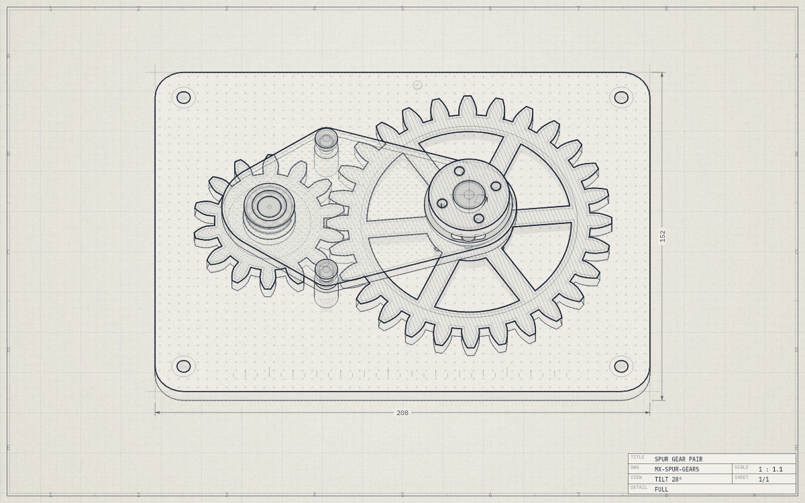
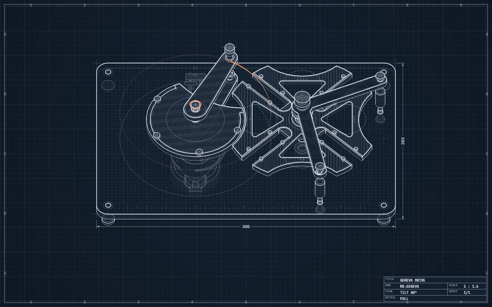
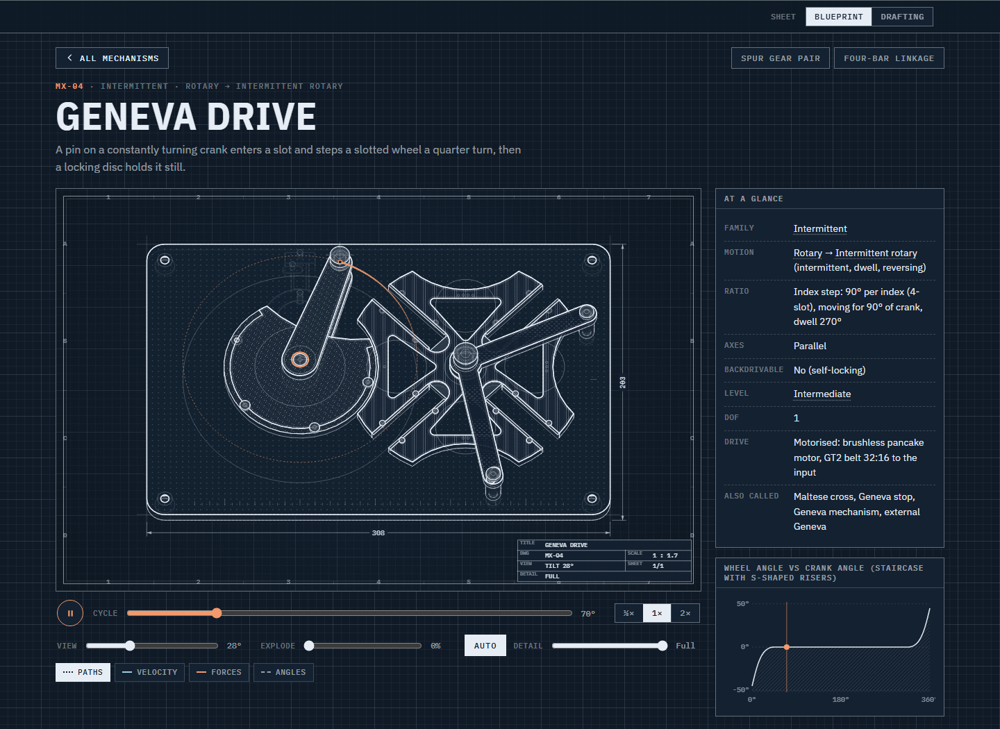

# Lex Mechanicum

**A library of mechanisms you can watch, turn and take apart, for a lesson, a build or plain curiosity.**

Every mechanism here is drawn live as a working drawing of a real bench build. The bearings sit in their bores, the
shafts have their keys and circlips, and most builds have a small motor and a belt to drive them. Press play and it
runs. Drag across the drawing to turn it by hand, tilt it to see it from the side, or explode it to see how it goes
together.

It's for anyone who wants to see how a mechanism really works: students and teachers, makers planning a build, or
anyone who has wondered what goes on inside a machine. It works well on a classroom screen, and every sheet comes
with a short, plain explanation.

**Open the library: https://gingerskull.github.io/lex-mechanicum/**



## What's in it

All 89 mechanisms in our catalogue are drawn, and we add more as we go. You'll find linkages and
straight-line linkages, gears, cams, indexing drives, couplings, belt and chain drives, escapements, ratchets and a
couple of mechanisms that bend instead of pivot. Each one has its own explanation, tags, examples and references.
They come from the same record as the drawing, so the text and the drawing always describe the same thing.



## Using a mechanism's page



**The drawing and its controls**

| Control | What it does |
|---|---|
| Play / pause | Runs the mechanism through its cycle. Space does the same while the drawing has focus. |
| Cycle | Moves to any point in the cycle. You can also drag across the drawing, or use the arrow keys. |
| ½× 1× 2× | Playback speed. |
| Wide, full screen | On a wide screen, Wide spreads the drawing across the page and puts the facts and the plot below it. Full screen gives the drawing the whole screen. |
| View | Tilts the drawing from plan (straight down) to a side view. |
| Explode | Pulls the assembly apart, layer by layer, so you can see what sits under what. |
| Auto, Detail | On Auto, the drawing drops its finest detail by itself if your device can't keep up. Move the Detail slider to pick the level yourself. |
| Paths, Velocity, Forces, Angles | Overlays: the paths the moving points trace, their velocity, the forces through the parts, and the angles that matter. |
| Sheet switch | The square button next to the name. It swaps white lines on blue (Blueprint) for pencil on paper (Drafting), and the site remembers your choice. |

A 3D sheet has a few more. You can orbit the drawing (drag it on a computer, or turn on Orbit on a phone), jump to a
named view such as Plan, Front, Side or Iso, cut a section or open a detail where the sheet has one, and change the
mechanism itself with its own sliders, like the bend of a universal joint.

**Around the drawing**

- **At a glance:** family, kind of motion, ratio, axes, whether it can be driven backwards, level, degrees of
  freedom and how this build is driven. Family, motion and level link to the library, filtered to match.
- **The plot:** the output over one cycle, with a marker that follows the drawing.
- **Tags:** what it does, its properties and where it's used. Each tag links to the mechanisms that share it.
- **How it moves, Forces, Why use it, Limits:** a short explanation in four parts.
- **Where you will find it** and **In the real world:** typical uses, and real products that use it.
- **References, photos, video and animations** if you want to read more.

On the library page you can search by name, use or tag. Filters narrows things down by family, motion and more, and
Sort changes the order: newest first, by name or by sheet number. The page address keeps your filters, search and
order, so a link shows someone else exactly what you see.

## How it's made

Each mechanism starts from its kinematics alone, in its catalogue record. A hardware builder then adds the parts a
real build would need, as true 3D solids: bearings sized to the load, shafts and what holds them in place, bridges
over the pivots, stops, lubrication, fasteners and a drive. Every build is checked for clashes in 3D over its whole
cycle before it's drawn. The site is static: each page loads one small package, and your browser draws it with WebGL2.

If you'd like to help, the details are in [docs/architecture.md](docs/architecture.md),
[docs/mechanism-standard.md](docs/mechanism-standard.md), [docs/style-reference.md](docs/style-reference.md) and
[docs/workflow.md](docs/workflow.md).

## Running it locally

```
npm ci                    install
npm run dev               the site with live reload
npm run check             typecheck, lint, unit tests, conformance
npm run build             the static site into dist/site
npm run shot <id>         draw one frame of a mechanism to a PNG (local Chrome)
npm run thumbs            redraw the library thumbnails that are out of date
```

We track the work on the project board (see [docs/workflow.md](docs/workflow.md)).

## Licence

- **Code** (everything not listed below): MIT, see [LICENSE](LICENSE).
- **Content**: the catalogue (`data/catalog/`), the documents and images in `docs/`, and the drawings the site
  renders: Creative Commons Attribution-ShareAlike 4.0, see [LICENSE-CONTENT](LICENSE-CONTENT). Please credit
  "Lex Mechanicum" with a link to this repository, and share adaptations under the same licence.

Linked references, photos and videos belong to their owners and aren't covered. The IBM Plex fonts the site ships
are under the SIL Open Font License 1.1.
